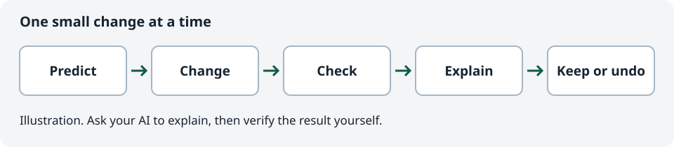

# AI Build Lab

Learn to build apps with an AI tutor.

Start here even if you have never written code, opened a terminal, or used GitHub. Learn to read a short piece of documentation, use AI to explain it, then check the result in a small app.

**[Start the walkthrough](START-HERE.md)**

This repository is the guide. The small app in `exercises/` is lesson material. Documentation reviewed on **October 18, 2026**. [Sources, tool choices, and costs](docs/tools-and-costs.md).

If you already use Git:

```sh
git clone https://github.com/MokeyBytes/ai-build-lab.git
cd ai-build-lab
```

New to Git? The walkthrough explains how to get your copy with GitHub Desktop or a ZIP download.

## Your first session

1. [Read a short reference](lessons/00-read-the-docs.md) and check who published it.
2. Get a copy of this repository and open the exercise.
3. Ask your AI tutor to explain the relevant code.
4. Change one heading, check the result, and undo it.

The first exercise needs a browser and a text editor. It uses no cloud services, packages, API keys, or paid subscriptions.

Already have the repository open in an AI coding tool? Say:

```text
Read AGENTS.md and START-HERE.md. Help me start as a beginner.
```

Using a chat app? Follow the [instructions for a chat tutor](START-HERE.md#use-ai-as-your-tutor).

## How you will learn



Every lesson gives you something to do, a result to check, and a small challenge to try yourself. Ask for an explanation when a word or command is unfamiliar. Getting stuck is a reason to inspect what happened.

AI sometimes gives wrong answers and can make several changes when one would do. You will learn to give it a clear job, review its changes, test the result, and recover when something breaks.

## What you will build

The proposed course follows one project, **Tiny Wins**, a personal task tracker. It starts as a button and counter. Later lessons turn it into a useful app with saved tasks, accounts, and private data.

| Stage | What you learn |
| --- | --- |
| Read the docs | Find the original source, check its scope, and use AI to explain it |
| First change | Files, the browser, an AI tutor, checking and undoing a change |
| Development tools | An editor, Git, a terminal, and running an app locally |
| Small features | Planning, asking AI for bounded changes, and reviewing differences |
| Reliable behaviour | Debugging, tests, keyboard access, and handling bad input |
| Containers | Repeatable environments with Docker, plus a Podman route |
| Accounts and data | Supabase, migrations, and testing who can access each record |
| Publishing | Cloudflare Workers, configuration, deployment checks, and rollback |
| Keeping it working | Costs, dependency updates, backups, and restoring data |
| Optional mobile track | React Native and Expo, device testing, signing, and release costs |

See the [learning path](docs/learning-path.md) for the proposed lesson outcomes.

## Tools and cost

We introduce tools when a lesson needs them. The proposed main path uses VS Code, GitHub, React with TypeScript and Vite, Docker Desktop, Supabase, and Cloudflare Workers. Podman is an alternative container track.

The target is $0 for the core learning exercises within free plan allowances. AI usage limits, cloud quotas, and store distribution can change that. See [tools and costs](docs/tools-and-costs.md) before creating accounts or upgrading a plan.

You can use the AI assistant you already have. The course does not require adding AI features to your app or buying model API credits.

## Current state

This is a course draft. [Reading the docs](lessons/00-read-the-docs.md) and [your first change](lessons/01-your-first-change.md) are written. Later lessons are a curriculum proposal. Documentation checks and practical testing are recorded separately in [validation](docs/validation.md).

For help, use [troubleshooting](docs/troubleshooting.md) or the [glossary](docs/glossary.md). For course development, read the [course design and release plan](docs/course-design.md).
