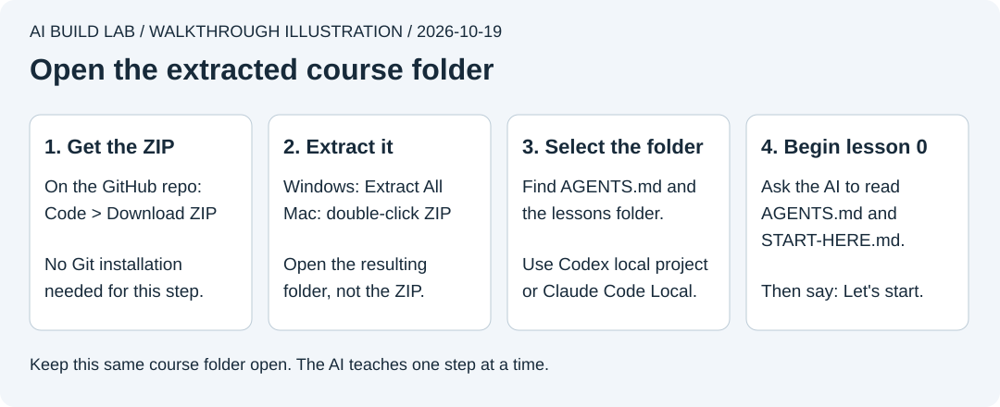

# Start here

Your AI desktop app is the place you will learn and work. First give it this repository's folder. Then ask it to teach you one step at a time.

Use a Windows computer or Mac with internet access and a browser. The first lessons run on that computer. Phone access to the finished web app comes later.

## Choose one desktop app

Use an account you already have access to. Check [current access and costs](docs/tools-and-costs.md#cost-boundaries) before subscribing or upgrading.

- **Codex desktop.** Follow the [official desktop guide](https://learn.chatgpt.com/docs/app). OpenAI's current documentation calls the app ChatGPT and includes Codex as a mode. Select Codex and work in a local project.
- **Claude Desktop.** Follow the [official Claude Code desktop guide](https://code.claude.com/docs/en/desktop-quickstart). Use its **Code** tab for this course and select **Local** as the environment.

The desktop apps provide the coding interface. You do not need to install VS Code or a standalone coding CLI for these routes. A CLI is a terminal interface; we can introduce it later if you want one.

If you cannot use either coding workspace without an upgrade, you can read [lesson 0](lessons/00-read-the-docs.md) and use the [manual/chat alternative](#manualchat-alternative).

## Get your copy

A repository is a project with files and a history of changes. For your first session, a downloaded copy of the files is enough.

1. Open [AI Build Lab on GitHub](https://github.com/MokeyBytes/ai-build-lab).
2. Choose **Code > Download ZIP**.
3. On Windows, right-click the ZIP and choose **Extract All**. On macOS, double-click it.
4. Open the extracted folder. You should see `README.md`, `AGENTS.md`, `CLAUDE.md`, and the `lessons` folder.

The extracted folder may be called `ai-build-lab-main`. That is fine. Keep it somewhere you can find again, and use that same copy throughout the course. On Windows, leave the ZIP view and open the extracted folder before continuing.



It shows the files to find rather than a particular app's button layout.

A ZIP contains the files but not Git's history. [GitHub explains the difference](https://docs.github.com/en/repositories/working-with-files/using-files/downloading-source-code-archives). We introduce Git when you need checkpoints and recovery.

If Git is already installed, you can clone instead:

```sh
git clone https://github.com/MokeyBytes/ai-build-lab.git
cd ai-build-lab
```

## Open the local folder

In Codex, add the extracted or cloned folder as a local project. Follow the official [local-project instructions](https://learn.chatgpt.com/docs/projects?surface=app) if the controls differ in your version.

In Claude Desktop's Code tab, select **Local > Select folder** and choose that same folder. Use a session that works directly in this folder for the first exercise. If offered a separate Git worktree, leave it off. A worktree is another checkout of a Git repository and is unnecessary here.

Select the folder containing `AGENTS.md`. A chat with uploaded files can have different access from a local coding session. See [the desktop workspace guide](docs/coding-agents.md).

`AGENTS.md` and `CLAUDE.md` are the instruction files for our coding tools. `.md` means Markdown text. You open the project in the app; you do not run these files. Keep their exact names, without an extra `.txt` extension. [How both tools share the instructions](docs/coding-agents.md#shared-tutor-instructions).

Keep the app's permission controls active. Lesson 0's [safety walkthrough](docs/ai-safety.md#check-access-before-the-first-edit) shows which mode to choose before editing.

Paste:

```text
Read AGENTS.md and START-HERE.md. Let's start.
```

The tutor should begin [lesson 0](lessons/00-read-the-docs.md) with a documentation source and one small step. It should ask about your computer and account access when those details matter.

## Save your progress

When you stop, ask the tutor to create or update `.learning/progress.md` using [the progress template](templates/progress.md). Read any existing note first and preserve information you still need. The `.learning` folder is ignored by Git. Ask for the saved note's full path. Paste those notes into a later session, or ask the tutor to read that file, to resume.

From lesson 2 onward, use [Find your files and resume work](docs/local-workflow.md) for the app folder, command examples, and starting or stopping services.

## Manual/chat alternative

Use an existing AI chat and a plain-text editor. Copy the [tutor instructions](prompts/tutor.md), the current lesson, and the relevant file contents into the chat. You can read these Markdown files on GitHub. [VS Code](https://code.visualstudio.com/docs/getstarted/overview) is optional.

- On Windows, open the existing HTML file in Notepad to edit it, then save with Ctrl+S. In File Explorer, **View > Show > File name extensions** lets you confirm it remains `index.html`, not `index.html.txt`. [Microsoft's file extension guide](https://support.microsoft.com/en-us/windows/experience/storage-filemanagement/common-file-name-extensions-in-windows).
- On Mac, TextEdit must show HTML as code and use plain text. Follow [Apple's HTML editing instructions](https://support.apple.com/guide/textedit/work-with-html-documents-txted0b6cd61/mac), then save the existing `.html` file with Command+S. Rich-text formatting can alter the code.

In lesson 1, apply the heading change yourself using the printed before and after lines. Save the file and refresh the browser. The same checks and recovery exercise apply. A chat that cannot read your folder or edit files should say so.
