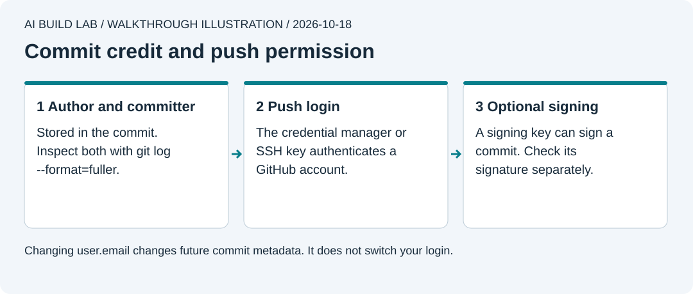

# GitHub and identity on your computer

Use this with [lesson 2](../lessons/02-keep-your-work.md). The main route is Git over HTTPS, with browser sign-in handled by a credential manager. You can stay in your AI desktop app while it runs Git.

## Which identity does what?



This is an authored walkthrough illustration, not a product screenshot.

| Identity | What it means | Where to check |
| --- | --- | --- |
| Computer account | The Windows or Mac user running the app and holding local files and credentials | Your operating system's account settings |
| Commit author | The identity credited with the original work | `git log -1 --format=fuller` |
| Committer | The identity that created this commit object | The same log output, under `Commit` |
| Authenticated GitHub account | The account whose credential authorizes the push | Your credential manager's browser sign-in, or `gh auth status` if using GitHub CLI |
| Signing key | Optional evidence that a commit was signed with a particular key | The commit's signature details on GitHub |

Git stores author and committer separately. They often match on your own commits. Applying someone else's patch can preserve their authorship while recording you as committer. A push uploads existing commits and does not replace those names. [Git's explanation](https://git-scm.com/book/en/v2/Git-Basics-Viewing-the-Commit-History).

Setting `user.name` and `user.email` writes commit metadata. It does not log in to GitHub or grant access to a repository. Email links commit credit to your GitHub profile. [GitHub's attribution guide](https://docs.github.com/en/pull-requests/how-tos/commit-changes/troubleshooting-commits).

## Set credit for this app

1. In GitHub, open your profile picture, **Settings > Emails**. Verify your account email. To keep it private in commits, copy the exact GitHub-provided `noreply` address shown there. Do not guess its format. [Email reference](https://docs.github.com/en/account-and-profile/reference/email-addresses-reference).
2. Tell the AI the display name and commit email you choose. These become visible to anyone who can read your repository's history.
3. Ask it to show the app repository's full path and inspect the effective settings. Never paste a full credential configuration dump into chat.

These read-only commands show the source of each setting and the identities Git would use now:

```sh
git config --show-origin --get user.name
git config --show-origin --get user.email
git var GIT_AUTHOR_IDENT
git var GIT_COMMITTER_IDENT
```

An unset value can produce no output. Environment variables or app settings can override Git config. If the effective identities differ from your choice, ask the AI to explain the source before changing anything. [Git identity settings](https://git-scm.com/docs/git-config#Documentation/git-config.txt-username).

After replacing the placeholders, these commands set credit **only in this app repository**:

```sh
git config --local user.name "YOUR CHOSEN DISPLAY NAME"
git config --local user.email "YOUR EXACT COMMIT EMAIL"
```

Recheck the effective identities. Keep personal and employer identities separate. Repeat this check on every computer and new repository. Changing the setting affects future commits; it does not repair older ones. [Repository-specific email settings](https://docs.github.com/en/account-and-profile/how-tos/email-preferences/setting-your-commit-email-address).

For AI-assisted work, keep the learner's chosen identity when the learner directs and accepts the work. Inspect what the coding app actually records. Do not invent an AI email or silently override an existing attribution policy. An optional `Co-authored-by` trailer credits another contributor; it does not authenticate a push. [Multiple authors](https://docs.github.com/en/pull-requests/how-tos/commit-changes/creating-a-commit-with-multiple-authors).

## Let this computer push

Use one existing authentication route. A GitHub connection in an AI app does not by itself prove that the local Git process can push.

- On Windows, current **Git for Windows** includes Git Credential Manager. Use its browser login when Git asks for authentication.
- On Mac, use Git Credential Manager's installation instructions if there is no working HTTPS credential helper. The official GitHub guide describes its Homebrew route. Ask the AI to inspect your existing setup before adding another helper.
- If you already use GitHub CLI, `gh auth login` can configure HTTPS Git authentication. Choose GitHub.com, HTTPS, browser login, and allow it to authenticate Git. `gh auth status` checks the selected account; do not add `--show-token`.

GitHub documents these routes in [caching credentials](https://docs.github.com/en/get-started/git-basics/caching-your-github-credentials-in-git). Sign in yourself on the official browser page. Check the account and permissions there. Keep passwords, access tokens, recovery codes, and private keys out of the AI chat and repository.

A GitHub account password is not an HTTPS Git password. Use the credential helper rather than making and pasting a token for this course. Credentials belong in the OS credential store. Avoid Git's plain-text `credential.helper store`. [Credential storage](https://git-scm.com/book/en/v2/Git-Tools-Credential-Storage).

## If you already use SSH

Keep a working SSH setup. For a new computer, generate a separate key pair with a descriptive device name and passphrase. Register only its public key with GitHub and keep the private key on that computer. Check GitHub's host fingerprint before trusting a first connection. Revoke a lost computer's key. [SSH key setup](https://docs.github.com/en/authentication/connecting-to-github-with-ssh/generating-a-new-ssh-key-and-adding-it-to-the-ssh-agent), [connection test](https://docs.github.com/en/authentication/connecting-to-github-with-ssh/testing-your-ssh-connection).

An SSH authentication key permits access. Commit signing is a separate setup. A GitHub **Verified** signature concerns the commit's signature, not whether the app works or the code is safe. Add signing when your project or organization requires it. [Signature verification](https://docs.github.com/en/authentication/managing-commit-signature-verification/about-commit-signature-verification).

## When a machine acts without you

Your supervised desktop session can use your own account. Future unattended automation needs an explicit permission design. Prefer a GitHub App with access to the required repositories and short-lived installation tokens. Do not copy your personal credentials onto a shared server. A bot's commit identity and its push credential still need separate checks. [GitHub App authentication](https://docs.github.com/en/apps/creating-github-apps/authenticating-with-a-github-app/about-authentication-with-a-github-app).

## Before any push

Ask the AI to show the app folder, destination owner/repo, branch, commit IDs, author, committer, and staged diff. Confirm the destination is yours. Inspect file contents for secrets, including files already tracked before `.gitignore` existed. A successful push needs verification on GitHub. A local commit alone is no proof of upload.

If authentication uses the wrong account, stop before the push. Follow the credential helper's account-switching instructions. Changing `user.email` will not change the login. If a commit has the wrong credit, correct future settings first and inspect whether that commit was shared. Do not rewrite shared history as an automatic fix.
