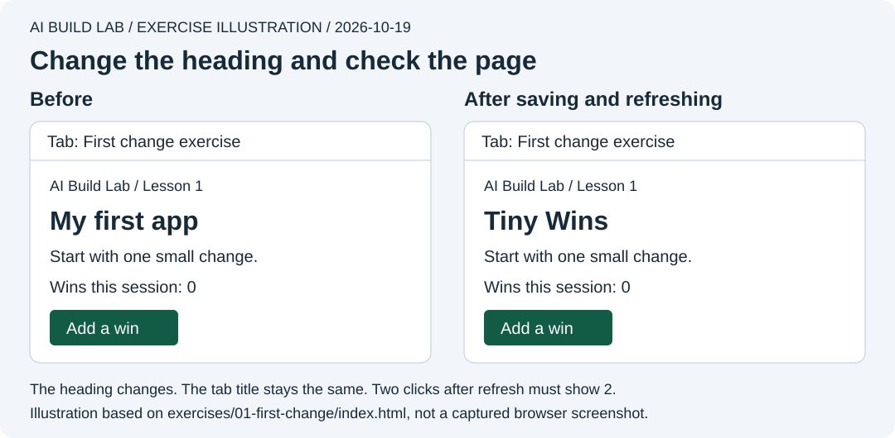

# Lesson 1: your first AI-made change

Ask the AI to change a heading, check the result yourself, then have it undo that edit. Allow about 20 minutes after [desktop setup](../START-HERE.md). The exercise uses no hosting or database account; AI access follows your plan.

Finish lesson 0's [safety practice](../docs/ai-safety.md) first. Keep that permission mode active and review the proposed heading change before applying it.

Use [MDN's heading reference](https://developer.mozilla.org/en-US/docs/Web/HTML/Reference/Elements/Heading_Elements) and [title reference](https://developer.mozilla.org/en-US/docs/Web/HTML/Reference/Elements/title) from lesson 0. These sources were checked on October 18, 2026.

## Open the exercise

1. In File Explorer on Windows or Finder on macOS, open the repository folder, then `exercises`, then `01-first-change`.
2. Double-click `index.html` and choose a browser if asked. You can ask your AI to help locate this exact file.
3. Find the heading **My first app**, the number **0**, and **Add a win**.
4. Click the button twice. The number should show **2**. Refresh the page. It should return to **0**.



Authored illustration based on the exercise file. The browser-tab title is separate from the heading inside the page.

The `file:` address means you opened a file on your computer. This version keeps the counter in memory and does not save it.

## Ask for a proposal

In your AI desktop app, with this repository selected, send:

```text
Read exercises/01-first-change/index.html. Explain the heading and the
button in plain English. Propose changing only the visible heading
from "My first app" to "Tiny Wins". Show the before and after line.
Do not edit anything yet. Ask me what I expect to change, then wait.
```

The proposal should show:

```html
<h1>My first app</h1>
```

changing to:

```html
<h1>Tiny Wins</h1>
```

Predict what will happen to the heading, browser tab, and button. Check your app's permission controls as explained in [the workspace guide](../docs/coding-agents.md).

## Let the AI make the change

After reviewing the proposal, say:

```text
Apply only that heading change. Show which file and line changed.
Do not change the script, styles, browser-tab title, or other files.
```

Approve the proposed edit if your app asks. Inspect the changed lines in the app. If no diff view is available yet, ask the AI to display the saved heading line and inspect the file in the app's file viewer where available.

Refresh the browser yourself. Check that:

- The heading says **Tiny Wins**.
- The browser tab still says **First change exercise**.
- Two button clicks still show **2**.

Refresh first, then click twice. The refresh starts the counter at zero; saving the file alone does not refresh an already open page.

An AI saying "done" does not establish those results. Report what you actually observe. If it differs, use [troubleshooting](../docs/troubleshooting.md).

## Undo this edit

Ask the AI to restore only the heading text it changed, keeping any other work. It should return to `<h1>My first app</h1>`.

Refresh and confirm that the original heading appears. Avoid a whole-project reset for a one-line change. We will learn Git checkpoints in the next lesson.

## Try your own request

Choose a new heading and write your own request for it. Include what may change and how you will check it. Review the proposal, let the AI apply it, and test the heading and button.

You have completed this lesson when you can direct a small change, inspect it, verify the behaviour, undo that edit, and explain why the browser-tab title and counter behaved as they did.

Ask the tutor to help record [your progress](../templates/progress.md), then continue to [lesson 2](02-keep-your-work.md). For manual editing with an ordinary chat, follow [the alternative route](../START-HERE.md#manualchat-alternative) using the same before and after lines.
