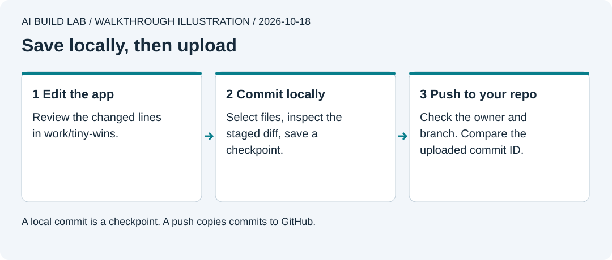

# 2. Keep your work

You will save a checkpoint, recover one edit, and upload your app to your own GitHub repository.

Allow 45 to 60 minutes after lesson 1. Git and a GitHub Free account are enough. AI access follows your plan. You will choose a private repository for the exercise.

Git saves history on your computer. GitHub stores an uploaded copy under an account you control. If you do not have an account, follow [GitHub's sign-up guide](https://docs.github.com/en/get-started/start-your-journey/creating-an-account-on-github), verify your email, and keep your login and recovery codes private.

## Start in the desktop app

```text
Read AGENTS.md and lesson 2. Teach one step at a time.
Explain Git and GitHub with this exercise. Check whether Git is installed.
Keep the course open as our workspace. Put my app in work/tiny-wins,
with its own Git repository. Never run app Git commands in the course repo.
Show the full working directory before each group of commands.
```



Authored walkthrough illustration. The steps below do not depend on a particular app layout.

## Make an app folder

1. Ask the AI to check `git --version`. If Git is missing, use [Git's installation guide](https://git-scm.com/book/en/v2/Getting-Started-Installing-Git). On Windows choose Git for Windows. On Mac follow the Mac option. Restart the AI app after installation if it cannot find Git.
2. Ask it to create `work/tiny-wins` inside the course folder. Copy only the first exercise's `index.html` there, plus the reference app's [`.gitignore`](../reference/tiny-wins/.gitignore). Add a short `README.md` naming your app. Keep the original exercise as it is.
3. Check the new folder in File Explorer or Finder. Open its `index.html` and check the counter. The course's `.gitignore` excludes `work/`; this folder will have its own history.
4. Ask the AI to initialize Git in **that app folder**. `git init -b main` creates local history storage with a `main` branch. It uploads nothing. Check `git rev-parse --show-toplevel`; the result must end in `work/tiny-wins`.

Keep the course folder open in the desktop app. The AI reads lessons here but runs the app's commands with `work/tiny-wins` as its working directory. If you move to a new AI chat, paste the lesson number and both folder paths.

Use [the folder and command guide](../docs/local-workflow.md) if a path or terminal message is unfamiliar. The AI should explain and run the commands; you inspect the results.

## Choose your identity before committing

Work through [GitHub and identity](../docs/github-identity.md), through "Let this computer push." Have the AI show your effective author and committer. Confirm your chosen display name and exact commit email. Sign in to GitHub yourself when needed.

Your machine name is not your GitHub identity. The commit's author, its committer, and the account allowed to upload it each have a different job.

## Save a checkpoint

1. Ask for `git status --short` and the files proposed for the first checkpoint. Open the files and review their contents. New, untracked files do not appear in a normal `git diff` yet.
2. Ask the AI to stage only `index.html`, `.gitignore`, and `README.md`. Staging selects content for the next checkpoint. `git diff --cached` shows that selection.
3. Once you accept that selection, ask it to commit with a plain message such as `Save the first working counter`. A commit saves the staged content locally.
4. Ask for `git log -1 --format=fuller` and `git status --short`. Check the author, committer, message, and commit ID. Status should have no remaining changes.

[Git's recording-changes guide](https://git-scm.com/book/en/v2/Git-Basics-Recording-Changes-to-the-Repository) explains the working files, staging area, and commit.

## Recover one edit

Ask for a temporary change to the app heading. Inspect `git diff` and check the page. Then ask the AI to show exactly what a recovery would discard.

For this single, uncommitted heading edit, `git restore -- index.html` copies the committed version back into that file. Run it only after checking that the file contains no other work you want. Refresh the page and check that status is clean. [Git restore](https://git-scm.com/docs/git-restore).

For a mistake that was already committed and shared, ask about `git revert COMMIT_ID`. It records an inverse change in a new commit and can need conflict resolution. Avoid force-pushes and whole-repository resets for this exercise.

## Upload to your own GitHub repo

1. Sign in at GitHub. Use **New repository**, choose your own account as owner, name it `tiny-wins`, and choose **Private**. Leave README, licence, and `.gitignore` initialization off because you already have local files. [Official import walkthrough](https://docs.github.com/en/migrations/importing-source-code/using-the-command-line-to-import-source-code/adding-locally-hosted-code-to-github).
2. Copy the new repository's HTTPS URL. Give the AI that URL. Ask it to add it as the app's `origin`, then show `git remote -v` and the current branch. The destination must be **your account/tiny-wins**, not `MokeyBytes/ai-build-lab`.
3. Ask for the last commit's diff, author, and committer. Check that no credentials, private logs, or real personal data are included. `.gitignore` does not remove secrets from past commits.
4. Tell the AI to push this reviewed commit to your private repo. `git push -u origin main` uploads it and remembers the branch relationship. Complete any browser sign-in yourself.
5. Open the repo on GitHub and select `main`. Check the same commit ID and open `index.html`. Have the AI compare `git rev-parse HEAD` with `git ls-remote origin refs/heads/main`. The full IDs must match.

A denied push can mean the wrong login, wrong URL, missing permission, or repository rules. A rejected push is a reason to inspect the message. Do not bypass it with `--force`.

An ignored file can still be readable by the AI. `.gitignore` controls tracking, not tool access. If a real credential enters a commit or chat, stop sharing it and follow [the leaked-secret steps](09-keep-it-working.md#if-a-secret-leaks) before continuing. Deleting the line alone does not invalidate the credential.

## Try it yourself

Write your own request for a one-line README improvement. Review it, commit it, and push it. Show the uploaded change on GitHub. Explain which action saved locally, which action uploaded, and which identity supplied permission.

Record the app folder, remote owner/repo, branch, commit ID, and what you verified in your [progress notes](../templates/progress.md). Never record credentials there.

[Previous](01-your-first-change.md) · [Next: build Tiny Wins](03-build-tiny-wins.md)
