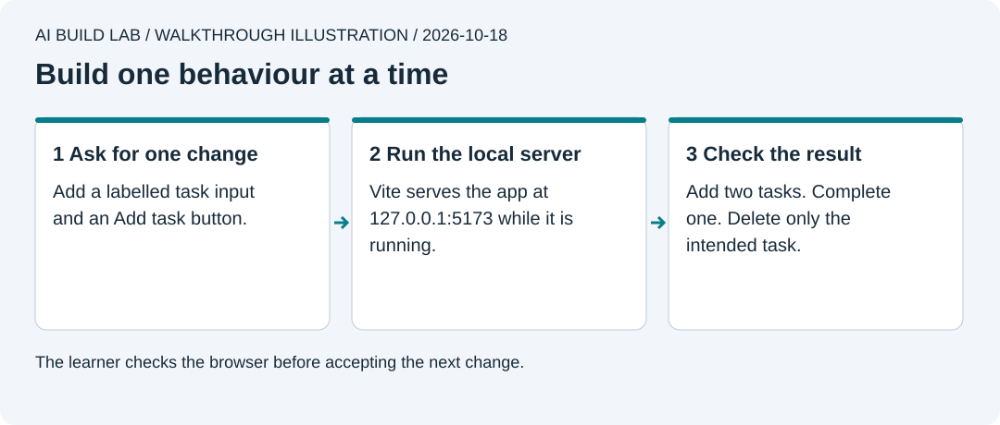

# 3. Build Tiny Wins

You will turn the counter into a task tracker that can add, complete, and delete a task.

Allow 60 to 90 minutes after lesson 2. Use your existing AI desktop workspace and app repository. No hosted service is needed. Node and the packages are free downloads.

## Meet the tools

React builds the interface from components, reusable pieces such as a task list. TypeScript checks how the code uses values. Vite starts the development server and builds the release files. Node runs these development tools, and npm downloads the packages they need.

`package.json` lists the project's packages and commands. `package-lock.json` records the resolved package versions so another install can reproduce them. You will review both when packages change.

Ask the AI to open the relevant sections of [React's from-scratch guide](https://react.dev/learn/build-a-react-app-from-scratch), [Vite's guide](https://vite.dev/guide/), and [TypeScript's introduction](https://www.typescriptlang.org/docs/handbook/typescript-in-5-minutes.html). Ask which tool draws the interface, which starts the local server, and which checks types. Type checks cannot validate everything a user enters.



A local server runs on your computer while you work.

## Prepare the app

1. Ask the AI to check `node --version` and `npm --version`. Install **Node 24 LTS**, long-term support, from the [official download page](https://nodejs.org/en/download) if needed. Choose the prebuilt Windows `.msi` or Mac `.pkg` installer for your processor. npm comes with Node. Restart the AI app and recheck. Expect Node's version to begin `v24.`. The reference is checked with 24.22.0. [Node's support table](https://nodejs.org/en/about/previous-releases) explains LTS. Do not replace an employer-managed runtime without checking its rules.
2. Ask the AI to confirm a clean Git checkpoint in `work/tiny-wins`. A branch is a separate line of saved work. Create one named `build-task-tracker` so you can review the task tracker before combining it into `main`. Keep all commands in that app folder.
3. Ask for a small plan before replacing `index.html`. Start with a React page that shows only the heading. Keep the saved counter in Git history.

```text
Read lesson 3 and reference/tiny-wins/README.md. Work in work/tiny-wins.
Prepare a minimal React, TypeScript, and Vite app with the exact versions
listed in the reference package.json. Install only the React/Vite/type
packages needed now. Pin versions and create a package-lock.json.
Show the files you will replace first. Begin with just the heading.
Do not copy the completed reference App.tsx. Explain each command before running it.
```

The [reference folder](../reference/tiny-wins/README.md) is an answer key and a tested toolchain, not a requirement to copy the finished app. Ask for a hint first if you get stuck. Package installs download code and can run [installation scripts](https://docs.npmjs.com/cli/v11/using-npm/scripts/). Before accepting an install, have the AI show the exact package names, publishers, versions, and purpose. Use the official sources and the pinned reference versions. A lockfile records the choice; it does not establish that the code is safe.

4. Have the AI add `dev` and `build` scripts matching the reference. A script is a named command in `package.json`. For `dev`, keep the reference's host, port, and `--strictPort` settings so a busy port produces an error instead of another address. `npm run dev` starts Vite at `http://127.0.0.1:5173`. Open that address in your browser. Leave the server task running while you work. [Starting and stopping the app](../docs/local-workflow.md#reopen-the-app).
5. Check that the page shows your heading. This app needs the development server. Double-clicking its new `index.html` is no longer the right way to open it.

App commands in later lessons run from `work/tiny-wins`. The optional hook demo runs from the course folder. The AI should state the full path and use your actual shell. [The command guide](../docs/local-workflow.md#know-where-to-put-an-instruction) explains PowerShell, zsh, and the Windows `npm.cmd` and `npx.cmd` alternatives.

## Build one behaviour at a time

Ask for each row separately. Review its diff and check it in the browser before moving on.

| Ask the AI for | Check yourself |
| --- | --- |
| A labelled task input and Add task button | Type `Walk the dog`, press Enter, see one task |
| A unique ID for each task, title, completion state, and creation time | Two tasks with the same title remain separate |
| A checkbox to complete one task | Only the chosen task changes |
| A Delete button with a clear accessible name | Only the chosen task disappears |
| Trim spaces and reject blank titles or titles over 120 characters | Blank entry creates no task; a useful message explains invalid input |

Use the data shape in [tasks.ts](../reference/tiny-wins/src/tasks.ts) so later lessons can share the backup and database examples. Ask the AI to explain a task ID before adding it.

At this stage, losing tasks on refresh is expected. You will add storage in lesson 5. Say this aloud before testing it.

## Check and keep it

Ask the AI to run `npm run build`. It checks TypeScript and creates `dist/`, the browser files for release. A successful build does not prove that the buttons work. Check add, complete, and delete yourself, including duplicate titles and keyboard entry.

Review the changed files, commit the working result, and push `build-task-tracker` to your own repo. On GitHub, open **Compare & pull request** into `main`, inspect **Files changed**, and write what changed and how you checked it. This is your first pull request. Merge only after those checks pass. Ask the AI to switch locally to `main` and use `git pull --ff-only` to receive the merged result. [GitHub's pull request guide](https://docs.github.com/en/pull-requests/reference/pull-requests).

If a step breaks the app, stop and inspect the last diff. Ask for the smallest correction. Recover only the relevant edit after checking what would be lost.

## Try it yourself

Write your own request to improve the empty-list message. Give the AI the exact text you want, verify when it appears, and check that tasks still work. Explain why the server must stay running and what the build command checked. Save your evidence and commit ID in progress notes.

[Previous](02-keep-your-work.md) · [Next: describe a useful feature](04-describe-a-feature.md)
