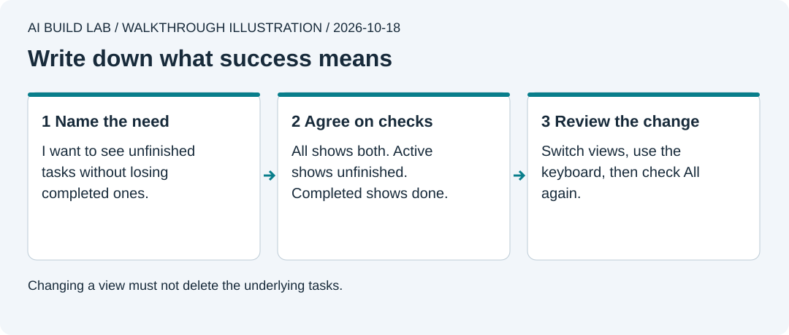

# 4. Describe a useful feature

You will add filters so someone can see unfinished tasks without deleting the rest.

Allow 30 to 45 minutes after lesson 3. Use the same app folder and desktop AI. No new tool, account, or paid service is needed.



Authored walkthrough illustration. Decide what success looks like before asking for code.

## Turn a need into checks

1. From the updated `main` in your app folder, [start Vite](../docs/local-workflow.md#reopen-the-app). Add `Read one page` and `Stretch`. Complete `Stretch`.
2. Describe the need in your own words. For example, "My list is busy. I want to see what I still need to do."
3. Ask the AI for a plan with the smallest change, affected files, and checks. Ask it to explain React state using [React's state guide](https://react.dev/learn/state-a-components-memory). A filter changes the view; the tasks remain in memory.

```text
Read lesson 4. Help me add All, Active, and Completed filters.
Write acceptance checks before editing. Show the affected files and explain
how we can undo this change. Keep the task list as the source of truth.
Do not add a database or a new library.
```

Agree on these results:

| View | Expected tasks |
| --- | --- |
| All | Read one page and Stretch |
| Active | Read one page |
| Completed | Stretch |
| All after visiting the other views | Both tasks still exist |

Also require a visible selected-filter state and keyboard-operable buttons. The reference uses native buttons and `aria-pressed`. Ask the AI to verify that choice in [MDN's toggle-button guidance](https://developer.mozilla.org/en-US/docs/Web/Accessibility/ARIA/Reference/Attributes/aria-pressed).

Storage comes in lesson 5. If an edit reloads the page and clears the in-memory list, add the two example tasks again before checking the table.

## Build, check, and review

1. From a clean app checkpoint, ask for a branch named `task-filters`.
2. Accept the small plan, then let the AI implement it. Review what changed. Ask why the filter must not remove tasks from the saved list.
3. Check every row above. Complete `Read one page` while viewing Active. It should leave that view and appear in Completed. Switch to All and count both tasks.
4. Use Tab and Enter to change filters. Check the selected state. Ask for `npm run build`, then commit, push the branch, and review its pull request before merging.

Follow [Finish a feature branch](../docs/local-workflow.md#finish-a-feature-branch) to bring the merged result back to your local `main` before the next lesson.

If tasks disappear from All, return to the last working checkpoint or ask for a correction to the filtering code. Do not rebuild the whole app to fix one filter.

## Try it yourself

Write a request for a count of unfinished tasks. Define what happens when you complete or delete one. Check those cases, including zero unfinished tasks. Explain the difference between hiding a task and deleting it.

Record the checks you performed. [The reference implementation](../reference/tiny-wins/src/tasks.ts) is available if your tutor needs to compare the logic.

[Previous](03-build-tiny-wins.md) · [Next: make it reliable](05-make-it-reliable.md)
