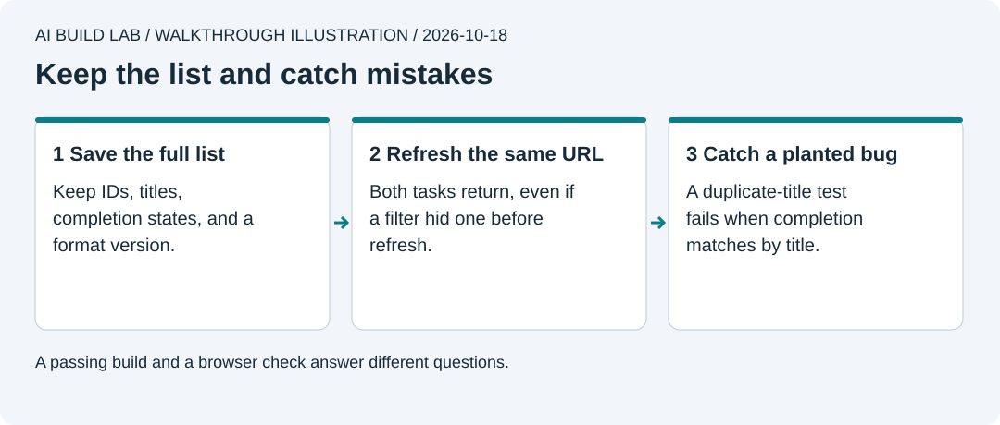

# 5. Make it reliable

You will keep tasks after a refresh, add useful tests, and fix a bug that a test catches. A test is code that checks an expected result and reports when it differs.

Allow 45 to 60 minutes after lesson 4. Start from the updated app `main` and [reopen Vite](../docs/local-workflow.md#reopen-the-app). No cloud account is needed. Use fake task titles.



Browser storage belongs to one browser profile and origin.

## Keep the list after refresh

1. Ask the AI to explain [MDN's localStorage reference](https://developer.mozilla.org/en-US/docs/Web/API/Window/localStorage). Storage persists across ordinary sessions but can be cleared, blocked, or unavailable. `127.0.0.1`, `localhost`, and different ports have different origins and can hold different lists.
2. Make a clean checkpoint and a `save-tasks` branch. Ask the AI to save the entire task list under `tiny-wins-v1`, using the versioned format in the reference's [tasks.ts](../reference/tiny-wins/src/tasks.ts).

```text
Read lesson 5. Add browser storage in work/tiny-wins.
Load once before saving, validate saved data, and show a clear error if
reading or saving fails. Do not overwrite unreadable data with an empty list.
Keep all tasks when a filter is active. Explain the storage format first.
```

3. Add two tasks and complete one. Select Active, refresh at the **same URL**, then select All. Both tasks must remain, including the completed one. Close the tab, reopen the same address, and check again.
4. Ask the AI to show where the browser stores this list using your browser's developer tools. Keep passwords, login tokens, and real private data out of this exercise.

This is storage on one device. It does not synchronize your phone, recover a lost browser profile, or replace a backup.

## Write a test that can catch a mistake

Ask the AI to explain the [Vitest getting-started guide](https://vitest.dev/guide/). Install the exact Vitest version in the reference's package manifest as a development dependency and commit the updated lockfile. Add `test` and `check` scripts like the reference.

Have it write tests for these behaviours before changing the task logic:

- A blank title creates no task.
- Two identical titles can have different IDs. Completing one must leave the other unchanged.
- Active and Completed views do not delete hidden tasks.
- A stored list can be parsed back with the same titles and completion states.
- Invalid saved data produces an error.

Ask the AI to run `npm test`. Then, on the exercise branch, ask it to temporarily change completion to match tasks by **title** instead of ID. Run the duplicate-title test again. It must fail. Inspect why, fix the implementation to use IDs, and run the tests again. Keep the test; remove the planted bug.

## Use the app without a mouse

Tab to the task input, type a title, and press Enter. Tab to its checkbox and use Space. Tab to a filter and press Enter. Delete the intended task using the keyboard. You should always see which control has focus, and every control needs a clear name. [MDN's keyboard guidance](https://developer.mozilla.org/en-US/docs/Web/Accessibility/Guides/Understanding_WCAG/Keyboard).

Ask the AI to run `npm run check`, inspect the diff, and commit the working result. Push and review the branch before merging. Tests cover the behaviours you wrote down. They do not replace the browser and keyboard checks you just performed.

[Update your local `main`](../docs/local-workflow.md#finish-a-feature-branch) after merging. You can now continue to containers. Optional lessons [5a](05a-instructions-and-hooks.md) and [5b](05b-skills-mcp-and-plugins.md) explain instructions, hooks, skills, MCP, and plugins when you want to explore those tools.

## Recover and try it yourself

If saved data will not load, keep a copy of its raw value before any repair. Ask the AI to diagnose the format without deleting storage. If saving fails, show the error and keep the previous confirmed list.

Write your own request for one missing edge-case test. Explain what wrong behaviour would make it fail. Show that failure once, then restore the correct code and get a passing check. Record the test output and your own browser checks.

[Previous](04-describe-a-feature.md) · [Next: use containers](06-use-containers.md)
