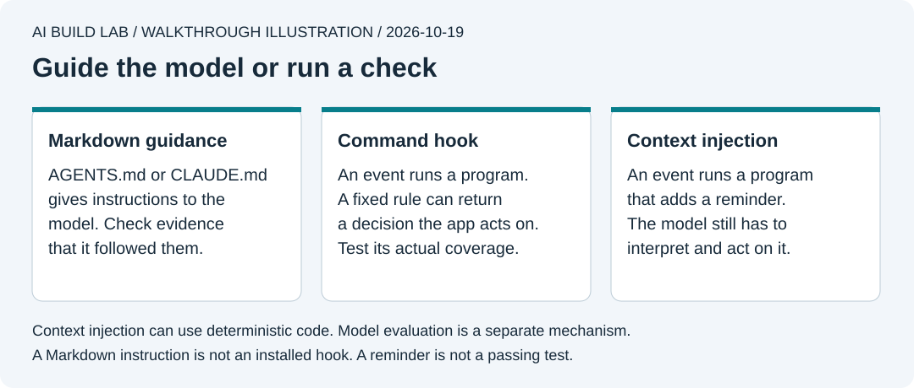

# 5a. Instructions and hooks

You will explain what your AI reads, what runs as code, and what needs a model's judgment. Then you will inspect a small hook without installing it into your desktop app.

This is an optional side lesson after lesson 5. Allow 30 to 45 minutes. Use the same desktop AI and Node installation. The exercise needs no new package, account, or model API key. You can go directly to [lesson 6](06-use-containers.md) without setting up hooks.

Official documentation checked on **October 19, 2026**. App integration still needs testing in each desktop client; see [validation](../docs/validation.md).

## Start with the files you already have

Ask the AI to open the course's `AGENTS.md` and `CLAUDE.md` and explain their contents without changing them.

- **`AGENTS.md`** is the project instruction file used by Codex. Use that exact spelling and capitalization. [Official OpenAI guide](https://learn.chatgpt.com/docs/agent-configuration/agents-md).
- **`CLAUDE.md`** is Claude Code's project instruction file. Here it contains `@AGENTS.md`, which imports our shared instructions. Current Claude Code can also load `AGENTS.md` directly depending on version and settings. Keeping the import supports sessions that need it. [Claude's instruction and import guide](https://code.claude.com/docs/en/memory).

The apps discover these files; you do not execute them to start the app. Keep shared rules in one place. Two copied rulebooks become easy to contradict.

`.md` means Markdown, a plain-text format for headings, lists, links, and other document structure. `# Heading` displays as a heading. A fenced command example is still text until someone or a tool executes it. See the [CommonMark reference](https://commonmark.org/help/).

The filename and the app's loader determine how the text is used. `README.md` explains the project to readers. `AGENTS.md` gives the coding agent instructions. A randomly named `notes.md` does not automatically become a project rulebook.

## Separate guidance from execution



Authored walkthrough illustration. A reminder to run a check and a program that runs the check have different effects.

| Mechanism | Tiny Wins example | What it establishes |
| --- | --- | --- |
| Markdown instruction | "Run the checks before reporting completion" | The model receives guidance; inspect evidence that it followed it |
| Conditional Markdown guidance | "For database changes, read the account-access lesson" | The model decides when the condition applies and follows the pointer |
| Deterministic command hook | A program checks a supported pending action and returns a deny decision | A coded rule determines that decision for that input and environment |
| Context-injection hook | A program adds an ownership reminder when the prompt mentions a migration | Extra context reaches the model; it does not prove the migration is safe |
| Model-based hook | A model judges whether the acceptance criteria were met | A model supplies an evaluation that can vary or be wrong |

A hook connects an event to a handler. The event might be a submitted prompt, a pending tool call, or a completed tool call. A handler is the command or other supported mechanism the app invokes. See [Claude's hook introduction](https://code.claude.com/docs/en/hooks-guide).

"Contextual hook" is ambiguous, so this course names the mechanism. A context-injection hook can use deterministic code. A conditional sentence in Markdown is a context pointer, not an installed lifecycle hook. A model-based hook asks an AI to evaluate something.

Automatic execution does not make every command deterministic. A command that calls a model or depends on changing external data can return different results. Predictable checks belong in code; use model judgment where a fixed check cannot answer the question.

## Try a hook with sample events

```text
Read lesson 5a and exercises/05a-hooks/README.md.
Show me the sample event and hook code before running it.
Predict the output with me, then run one sample at a time.
Keep the examples uninstalled. Do not create active hook settings.
```

Run these commands from the **course folder**, not the Tiny Wins app folder. Each reads a supplied JSON event and prints the demo's response. None writes the sample target file.

1. Read [the hook program](../exercises/05a-hooks/hook-lab.mjs). Its first rule recognizes a `Write` event for the exercise filename `lab-protected.txt` and emits a deny decision.
2. Predict what happens for a protected write, then ask the AI to run:

   ```sh
   node exercises/05a-hooks/hook-lab.mjs exercises/05a-hooks/protected-write.json
   ```

   Expect JSON containing `permissionDecision: "deny"`. Run it again. The same event should produce identical output.
3. Try the ordinary file:

   ```sh
   node exercises/05a-hooks/hook-lab.mjs exercises/05a-hooks/ordinary-write.json
   ```

   Expect no output. The hook has no decision. This does not approve the tool or bypass the app's permission checks.
4. Read the database prompt fixture, then run:

   ```sh
   node exercises/05a-hooks/hook-lab.mjs exercises/05a-hooks/database-prompt.json
   ```

   Expect `additionalContext` with a reminder about ownership and access checks. The code uses literal English keywords. It does not understand every way to describe a database change, inspect SQL, or run the checks.
5. Run `node --test exercises/05a-hooks/hook-lab.test.mjs`. The tests exercise the actual command with different events, Windows-style paths, and invalid input. Inspect the test results yourself.

This demonstrates the handler's output. It does not prove that your installed desktop app loaded a hook or blocked an action. The demo covers one `Write` input shape. Other edit tools, patches, shell commands, and outside programs are outside that rule. Hooks supplement permissions and checks; this filename rule is not a security boundary.

## Where real hooks are configured

| App | Project configuration | Current official reference |
| --- | --- | --- |
| Codex | `.codex/hooks.json`, or supported inline hooks in `.codex/config.toml` | [Configuration and project trust](https://learn.chatgpt.com/docs/config-file/config-advanced#hooks), [events, outputs, and hook trust](https://learn.chatgpt.com/docs/hooks) |
| Claude Code | The `hooks` setting in `.claude/settings.json` | [Hook configuration](https://code.claude.com/docs/en/hooks#configuration), [desktop settings compatibility](https://code.claude.com/docs/en/desktop#shared-configuration) |

The exercise includes an inactive [configuration example](../exercises/05a-hooks/hooks.example.json). Keep it there while learning. If you later choose to install it, ask the AI to inspect your existing settings, identify the actual desktop environment and absolute script path, and prepare a reviewed merge. Preserve existing hooks and trust controls. Test both a matching and non-matching event in that client, then demonstrate disabling only the new hook.

Review a command hook as a program that will run on your computer. Check what it reads, writes, and contacts before enabling it. A hook installed for safety still needs this review. [Codex hook trust](https://learn.chatgpt.com/docs/hooks), [Claude hook security](https://code.claude.com/docs/en/hooks#security-considerations).

Codex currently supports command and MCP-tool handlers; its docs say `prompt` and `agent` handlers are parsed but skipped. Claude Code supports prompt-based evaluation on selected events and experimental agent-based evaluation. These settings are not interchangeable. Check the linked references before copying a configuration. Model-based evaluation uses additional model work; do not assume that it is free.

A Git hook is another mechanism. It runs on a Git event such as a commit, rather than a coding agent's lifecycle. A local hook can be absent or bypassed. Use CI and applicable GitHub rules for checks the shared repository must enforce. [Git hooks](https://git-scm.com/docs/githooks), [GitHub rulesets](https://docs.github.com/en/repositories/configuring-branches-and-merges-in-your-repository/managing-rulesets/about-rulesets).

## Try it yourself

Write a small instruction and classify it. Does it belong in the shared Markdown rules, an objective check, a context reminder, or a model evaluation? Explain why.

Then write your own prompt that should trigger the database reminder, and one that should not. Have the AI test both without installing anything. Explain why a printed reminder is not evidence that access controls passed. Record the outputs and leave desktop integration marked untested unless you actually verified it.

[Previous](05-make-it-reliable.md) · [Next: skills, MCP servers, and plugins](05b-skills-mcp-and-plugins.md)
