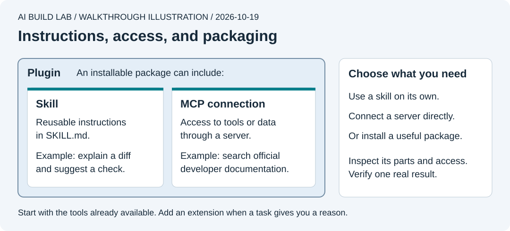

# 5b. Skills, MCP servers, and plugins

You will use a small skill to explain a change, then decide whether an external connection or plugin would help your project.

Allow 25 to 40 minutes after lesson 5a. Use your existing desktop AI access. The skill needs no service account. The optional documentation connection makes no model API calls; the AI's normal usage still counts. Official sources checked on **October 19, 2026**.

## Choose the tool for the job



Authored walkthrough illustration. Choose an addition when it solves a current problem.

| Part | What it does | Tiny Wins example | When you need it |
| --- | --- | --- | --- |
| Skill | Gives the AI a reusable procedure, usually in a folder containing `SKILL.md` | Explain a change in plain language before reviewing it | You keep asking for the same procedure |
| MCP server | Provides tools or data through Model Context Protocol | Search official documentation from inside the coding session | The AI needs access that its existing tools do not provide |
| Plugin | Packages capabilities for installation, such as skills, MCP connections, or hooks | A provider's development helper with instructions and a documentation connection | A trusted package already does a job you need |

A skill can work without MCP. An MCP connection can work without a skill or plugin. Reading local files and making the first app changes do not require any of these additions. See [OpenAI's customization guide](https://learn.chatgpt.com/docs/customization/overview) and [Claude's extension guide](https://code.claude.com/docs/en/features-overview).

Keep project-wide rules in `AGENTS.md` and `CLAUDE.md`. Put a procedure used for a particular task in a skill. A skill's Markdown guides the model; it does not enforce a deterministic rule. Skills can include scripts, but a `SKILL.md` is not itself a lifecycle hook. [Lesson 5a](05a-instructions-and-hooks.md) explains that difference.

## Try one small skill

Keep the **course folder** open in your desktop workspace. The example stays outside automatic skill folders until you choose to copy it.

1. Open [explain-change/SKILL.md](../exercises/05b-extensions/explain-change/SKILL.md). The lines between `---` markers are metadata. `name` identifies the skill; `description` helps the AI decide when to use it. The remaining text is the procedure. See the [Agent Skills format](https://agentskills.io/specification).
2. Ask the AI to use the file directly first:

   ```text
   Read exercises/05b-extensions/explain-change/SKILL.md and follow it.
   Explain one small change in work/tiny-wins. Show me the actual diff.
   Keep this read-only and separate what you observed from what needs testing.
   ```

   Expect a before/after explanation, a suggested check, and any unknowns. If there is no uncommitted change, identify a saved commit and file to explain. Reading a file on request does not establish automatic discovery.
3. To make it discoverable, ask the AI to copy only that example folder into the location for your app below. Have it show the full destination first and preserve any existing skill there. These exact practice folders are ignored by the course's Git settings.

   | Workspace | Folder inside the course | How to select it |
   | --- | --- | --- |
   | Codex desktop | `.agents/skills/explain-change/SKILL.md` | Open Skills in the sidebar. In the current desktop composer, type `@` and select the skill |
   | Claude Desktop, Code tab, Local | `.claude/skills/explain-change/SKILL.md` | Type `/explain-change`, or use **+ > Slash commands** |

   See [Codex skill discovery and selection](https://learn.chatgpt.com/docs/build-skills) and [Claude skill locations](https://code.claude.com/docs/en/skills). Codex CLI and its IDE extension use `/skills` or `$skill-name`; those are different entry points from the desktop picker.
4. Start a new local session in the same course folder if the skill is absent. Select it, ask for another small explanation, and inspect the diff it cites. Both tools can also choose relevant skills from their descriptions. Explicit selection makes this exercise easier to check. [Claude's desktop skill controls](https://code.claude.com/docs/en/desktop#use-skills).

If discovery fails, check the exact filename, folder, selected project, and current app version before installing anything else. To undo the practice setup, remove only the copy you added and start a new session. Keep the original exercise file.

## Optional: connect a documentation server

Use an MCP connection when you need a missing capability. For this example, [OpenAI's public Docs MCP](https://developers.openai.com/learn/docs-mcp) offers read-only documentation search and page retrieval at `https://developers.openai.com/mcp`. It does not call the OpenAI API for you. No API key belongs in these examples.

A remote HTTP server runs at the provider. A local STDIO server runs a program on your computer. You do not need Docker to connect to this hosted documentation server. Review a local server's program before allowing it to run. [Codex transports and configuration](https://learn.chatgpt.com/docs/extend/mcp), [Claude MCP setup](https://code.claude.com/docs/en/mcp).

1. Check whether your session already has this server, perhaps through a plugin. Use the existing connection if present.
2. If you choose to add it, use the route for your workspace:

   | Workspace | Setup |
   | --- | --- |
   | Codex desktop | Open **Settings > MCP servers > Add server**. Name it `openaiDeveloperDocs`, choose **Streamable HTTP**, enter the URL above, save, then select **Restart**. This configuration is shared with other Codex clients. For a project-only setup, use the inactive TOML example linked below instead |
   | Claude Desktop, Code tab, Local | **+ > Connectors** manages supported integrations. For this custom server, ask the AI to prepare a reviewed merge of the inactive JSON example into `.mcp.json` at the course root. Restart the local session and review any trust prompt |

   [Codex's desktop setup](https://learn.chatgpt.com/docs/extend/mcp#configure-in-the-chatgpt-desktop-app), [Claude's connector controls](https://code.claude.com/docs/en/desktop#connect-external-tools). The [example files and removal steps](../exercises/05b-extensions/README.md) show the different formats. Preserve existing settings.
3. Open `/mcp` in the coding session to inspect the connection. Then ask:

   ```text
   Use openaiDeveloperDocs to find Codex's current project skill folder.
   Show the documentation tool call, the supporting page link, and the answer.
   If the connection failed, report that rather than substituting a remembered answer.
   ```

   A saved setting alone is not proof. Check that a tool call returned documentation, then open its source. Keep this marked untested if you did not connect it.
4. Disable or remove only the server you added. Restart and check the server list. If you used an existing plugin connection, manage it through that plugin instead.

Other servers may read private records or change them. Check the provider, requested access, and account shown during sign-in. Git commit author and committer settings do not select an MCP connection's signed-in account. See [GitHub identity](../docs/github-identity.md).

## Browse a plugin before installing it

A marketplace is a catalog of plugins. It is not itself a skill or a server. A catalog entry does not establish that every bundled action suits your project. See [Claude's plugin introduction](https://code.claude.com/docs/en/plugins).

1. In Codex desktop, open **Plugins** and inspect a plugin's details. In Claude's Code tab, use **+ > Plugins > Add plugin** to browse configured marketplaces. [Codex plugin controls](https://learn.chatgpt.com/docs/plugins), [Claude plugin controls](https://code.claude.com/docs/en/desktop#install-plugins).
2. As a real example, read the [OpenAI Developers plugin guide](https://developers.openai.com/learn/developers-codex-plugin). It provides development guidance; its Claude version bundles the Docs MCP. The Codex version can also connect to OpenAI Platform for API tasks. Building Tiny Wins with AI does not require adding an AI API to Tiny Wins.
3. Identify the publisher, included skills, servers, scripts or hooks, sign-in needs, and possible charges. Decide whether it solves a current problem. You can finish this lesson without installing it.
4. If you choose to install a useful plugin, follow its current provider instructions for your app. Codex uses the plugin details' install control, then a new chat where you can select it with `@`. Claude uses the plugin browser; **Manage plugins** can enable, disable, or uninstall. Select a bundled skill through `/` using its listed name, such as `/plugin-name:skill-name`. Start a new session and verify one intended capability. A plugin's presence in the list is not proof that its server connected.

The basic skill format is portable, but app-specific metadata and plugin packaging can differ. Use the provider's package for your client. Do not rename a configuration file and assume compatibility. [OpenAI packaging](https://developers.openai.com/plugins/build/plugins), [Claude packaging](https://code.claude.com/docs/en/plugins).

## Try it yourself

Write your own request using `explain-change` on a different small diff. Show the cited lines and explain one check the AI has not performed.

Then choose an addition for each need: repeating your review procedure, retrieving a record from an external issue tracker, and sharing a prepared collection with a teammate. Explain when the existing tools are enough. Record which installations and connections you actually verified in [your progress notes](../templates/progress.md).

[Previous](05a-instructions-and-hooks.md) · [Next: use containers](06-use-containers.md)
