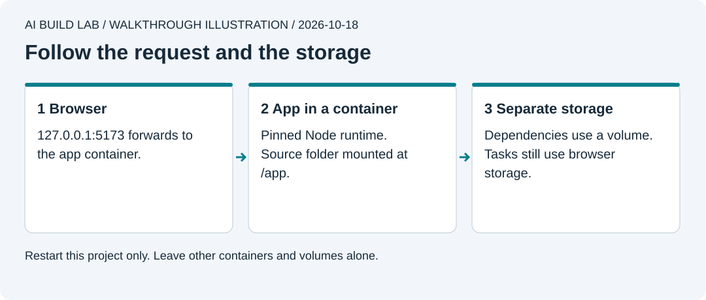

# 6. Use containers

You will run Tiny Wins in a container, restart it, and explain where its data lives.

Allow 45 to 60 minutes after lesson 5, plus download time. Docker Desktop is free for personal learning under its terms. Check employer or government licensing before using it at work. Lessons 5a and 5b are optional.

Containers are useful for repeatable services and tests. They are not required for every app. A browser interface, a Workers runtime, and a native phone app each have different execution environments. Here Docker prepares you for a local database in the next lesson.



Publishing a port forwards traffic; it does not move browser storage into the container.

## Check your computer first

1. Ask the AI to check the current Docker Desktop requirements for [Windows](https://docs.docker.com/desktop/setup/install/windows-install/) or [Mac](https://docs.docker.com/desktop/setup/install/mac-install/). Use a supported OS and the installer for your processor.
2. On Windows, use the documented WSL 2 route and Linux containers. Enabling WSL or hardware virtualization may need administrator help and a restart. Ask the AI to explain the exact missing requirement before changing Windows settings.
3. On Mac, choose Apple silicon or Intel as appropriate. Open Docker Desktop after installation and wait for the engine to be ready.
4. Ask for `docker version` and `docker compose version`. The first command must show a reachable server as well as a client. Docker Desktop's engine is the program running containers; having the app installed does not prove the engine is ready. A permission or engine error needs diagnosis before continuing. Do not expose Docker's socket or disable protections to make it work.

## Run the same app in a container

Start from updated local `main` in your app repository. Create a `local-containers` branch before adding the Compose file.

```text
Read lesson 6. Work in work/tiny-wins. Stop our existing Vite server.
Explain reference/tiny-wins/compose.yaml before copying it into my app.
Show the image version, port mapping, bind mount, and named volume.
Check that port 5173 is free. Use only this project's Compose resources.
```

The [Compose file](../reference/tiny-wins/compose.yaml) mounts your app folder at `/app`. A separate named volume holds Linux dependencies. Your task list still lives in browser storage. [Docker's Compose guide](https://docs.docker.com/compose/gettingstarted/) explains the file and service lifecycle.

A bind mount makes a computer folder available inside the container. A named volume is storage managed by Docker. You will inspect both in the next steps.

Before starting it, point to the app-folder mount and the `127.0.0.1` port binding in this file. Explain why it needs neither your home folder nor Docker's control socket. Do this by reading the configuration, without trying an unsafe mount. Bind mounts can let container programs change shared files on the computer. [Docker's bind-mount guidance](https://docs.docker.com/engine/storage/bind-mounts/) explains the access; containers need reviewed configuration to provide useful isolation.

1. Have the AI copy and explain the file. It should keep the pinned Node image and your committed npm lockfile.
2. `docker compose config` checks the resolved configuration without starting it. Confirm the port maps **127.0.0.1:5173** on your computer to port 5173 inside the container. This keeps the development service on your computer's loopback interface.
3. `docker compose up -d` downloads the image if needed, creates the service and volume, and starts the app. The first install can take a few minutes. Ask for `docker compose ps` and `docker compose logs --tail 30 web`. Wait for Vite's ready message.
4. Open `http://127.0.0.1:5173`. Check add, complete, and delete. At the same origin, your previous browser tasks should still be present.
5. Ask for a small heading edit. The bind mount lets the development server read the changed file. Check the result, then undo that one edit.

## Stop and restart

`docker compose stop` stops this project's containers. The page will no longer load after a full refresh. `docker compose start` starts those containers again. Check the app and tasks at the same address.

`docker compose down` removes this project's containers and network while retaining its named volume. `up -d` can recreate them. Adding `--volumes` would remove the named volume too; do not use it in this walkthrough. [Docker's storage explanation](https://docs.docker.com/get-started/docker-concepts/running-containers/persisting-container-data/).

| Item | Where it lives |
| --- | --- |
| Source files | Your app folder on the computer, mounted into the container |
| Installed Linux packages | The Compose dependency volume |
| Tasks in lessons 5 and 6 | Browser storage at this origin |
| Database tasks in lesson 7 | Supabase's own database volume |

If the port is busy, identify the process before stopping anything. If you choose another port, expect a separate browser-storage list. Never run a whole-machine prune to fix one project.

Review and commit the Compose file, then [merge and update local `main`](../docs/local-workflow.md#finish-a-feature-branch) before lesson 7.

## Try it yourself

Ask the AI to show which container, image, and volume belong to this app. Restart only this service and show that your source file and browser tasks survive. Explain why deleting a container is different from deleting a database volume.

Podman remains an alternative that needs its own compatibility check. Its Windows/Mac virtual machine and Docker API compatibility add setup choices; do not assume replacing the word `docker` proves the walkthrough works. [Supabase's supported local runtimes](https://supabase.com/docs/guides/local-development/cli/getting-started).

[Previous](05-make-it-reliable.md) · [Next: add accounts and data](07-add-accounts-and-data.md)
