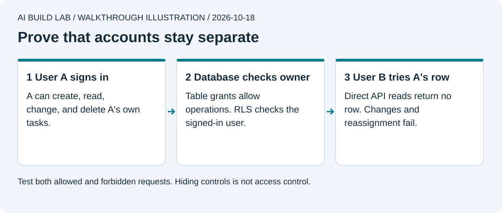

# 7. Add accounts and data

You will sign in with two local test accounts, save tasks in PostgreSQL, and prove that the accounts cannot access each other's tasks.

Allow 60 to 90 minutes after lesson 6. This lesson runs Supabase on your computer. It needs Docker, disk space, and enough memory for several services. It needs no Supabase cloud project or payment details. Keep all data fake.



Authored walkthrough illustration. Hiding a task in the interface does not protect it. The database must enforce access.

## Learn the roles

Ask the AI to explain the [local development guide](https://supabase.com/docs/guides/local-development/cli/getting-started), [API keys](https://supabase.com/docs/guides/getting-started/api-keys), [API access](https://supabase.com/docs/guides/api/securing-your-api), and [row-level security](https://supabase.com/docs/guides/database/postgres/row-level-security).

The publishable key identifies the app. A signed-in user's session identifies that user. Row-level security, or RLS, decides which rows they may use. The browser must never receive a secret or `service_role` key. A database password is another credential and stays outside the client too.

## Start local Supabase

```text
Read lesson 7 and the current Supabase changelog and local-development docs.
Work in work/tiny-wins. Explain each step before running it.
Add the exact supabase CLI and supabase-js versions in the reference manifest
only when we need them. Keep the lockfile. Use local services throughout.
Do not link or change any hosted project.
```

1. Check that Docker is ready. Stop the lesson 6 web container with `docker compose stop`; use the regular local Vite server for this lesson. Install the reference's pinned `supabase` CLI as a development dependency.
2. Ask the AI to inspect `npx --no-install supabase --help`, then the relevant subcommand's `--help`. `--no-install` uses your installed version and avoids fetching an unrelated newer CLI.
3. `npx --no-install supabase init` creates `supabase/config.toml`. Review the local project name and ports. `npx --no-install supabase start` downloads and starts local services. The first download is much larger than the web app.
4. The CLI reports local API, Studio, and mail-viewer addresses. Use those actual addresses. Open Studio and inspect it. Do not paste the full CLI status output into chat because it can contain privileged local credentials.

If the machine cannot run this stack, save progress. Choosing a hosted database is a separate decision with plan and privacy checks. Do not silently connect to an existing project.

## Create the table with a migration

1. Ask the AI to explain the reference [migration](../reference/tiny-wins/supabase/migrations/20261018153208_create_tasks.sql). Each task has an owner ID tied to an Auth user. The table has explicit API grants and RLS policies for reading, creating, changing, and deleting the owner's rows.
2. `npx --no-install supabase migration new create_tasks` creates a new, timestamped SQL file. Ask the AI to put the reviewed SQL into **that generated file**. Do not also run it manually in Studio.
3. `npx --no-install supabase migration up --local` applies pending migrations to your local database. Check the `tasks` table and its policies in Studio. `npx --no-install supabase db advisors --local` checks for database warnings; investigate any findings.

The UPDATE policy needs both a rule for the existing row and a rule for its new values. That stops an owner changing `owner_id` to somebody else. Explicit table grants matter too. The [2026 Data API change](https://supabase.com/changelog) means a SQL-created table must not depend on automatic exposure.

## Connect the app

1. Add the pinned `@supabase/supabase-js` package from the reference manifest.
2. Create `.env.local` from [`.env.example`](../reference/tiny-wins/.env.example). Enter only the local API URL and publishable key there. Your tutor can help identify the values without printing secrets. If your CLI exposes only a legacy local `anon` key, ask the AI to check the current key docs; never substitute `service_role`.
3. Have the AI verify that `.env.local` is ignored and untracked. Vite includes `VITE_` values in the browser build. Those values are public even when the file is ignored. Restart Vite after changing them. [Vite environment variables](https://vite.dev/guide/env-and-mode).
4. Ask for a small plan to add email/password sign-in and Supabase-backed task operations. Keep browser mode when both environment values are empty. Use [the reference app](../reference/tiny-wins/README.md) for comparison. Do not silently upload the old browser list to an account.
5. In local Studio, open **Authentication > Users > Add user** and create two fake test accounts with different emails and passwords. Use `learner-a@example.test` and `learner-b@example.test`. Confirm these local exercise accounts if the form offers that option. Do not change hosted email settings. See [user management](https://supabase.com/docs/guides/auth/managing-user-data). The [password sign-in API](https://supabase.com/docs/reference/javascript/auth-signinwithpassword) explains the client call.
6. Sign in as A, add `A's test task`, and reload. Sign out. The tasks must disappear. Sign in as B and check that A's task is absent. Add B's task, then switch back and check A's list.

Use separate browser profiles for simultaneous sessions. Two tabs in the same profile usually share sign-in storage. A reload fetches the current list; this small app does not promise live synchronization or offline cloud editing.

## Prove access through the API

Copy the reference's [access-check script](../reference/tiny-wins/scripts/check-access.mjs) into your app's `scripts/` folder and review it. It signs in as both test users, creates temporary rows, tries forbidden requests, and removes its own test rows. It never needs a secret key.

1. Copy [`.env.test.example`](../reference/tiny-wins/.env.test.example) to `.env.test.local`. Enter the local URL, publishable key, and the two fake account credentials. Keep this file ignored, out of chat, and out of screenshots.
2. Add the reference's `test:access` npm script, then run `npm run test:access` from the app folder.
3. Require each PASS line. Both users must read and change their own tasks. Neither may read, update, delete, reassign, or insert for the other. Unsigned requests must fail. A request returning an empty array can mean RLS hid rows; check affected-row counts as well as HTTP success.
4. Run `npm run check` and repeat the sign-in/out browser checks. Review and commit only source, migration, config, and lockfile changes. Check staged contents for secrets before pushing.

If any isolation check fails, stop. Do not publish the app. Fix the grants and ownership policies, then rerun the same checks. Never disable RLS or use a privileged key to make the client work.

## Recover and try it yourself

`npx --no-install supabase stop` stops this local stack while retaining its data. Start it again and verify the tasks. Do not use `db reset` or `stop --no-backup` as a troubleshooting shortcut; those can remove local data.

Write your own request to check what happens after signing out while a task is visible. Verify the result yourself. Explain the difference between app key, user identity, table access, and row ownership. Save the access-test output without credentials in your progress notes.

[Previous](06-use-containers.md) · [Next: put it online](08-put-it-online.md)
