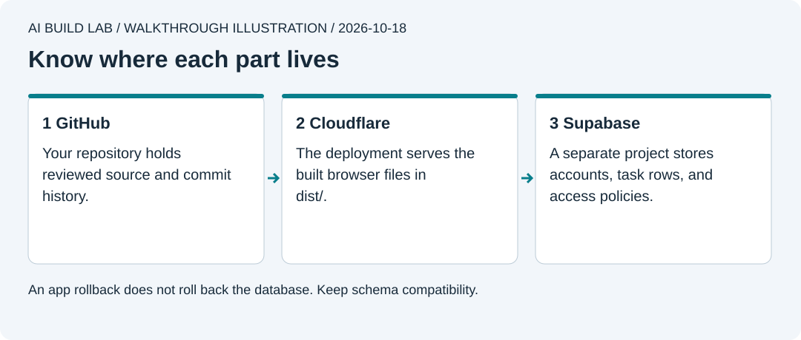

# 8. Put it online

You will prepare a small hosted pilot, verify it at its public address, and practice rolling back an interface change.

Allow 60 to 90 minutes after lesson 7, plus account setup. Use fake data and the current [cost checks](../docs/tools-and-costs.md). Free allowances can change. You can finish the local preparation and stop before creating hosted resources.



Authored walkthrough illustration. A private source repository does not make a deployed URL private. Account policies protect the data.

## Prepare before publishing

```text
Read lesson 8 and the current official deployment and plan docs.
Prepare a release from my reviewed app commit. Show the GitHub destination,
Cloudflare account and project name, Supabase project, public URL behaviour,
cost limits, account restrictions, and rollback plan.
Do the local preparation first. Wait for my separate decision before creating
hosted resources, changing a remote database, or publishing the app.
```

1. Confirm lesson 7's access checks passed. Run `npm run check`. Record the exact app commit ID and verify it is pushed to your GitHub repo.
2. Ask the AI to explain [Workers static assets](https://developers.cloudflare.com/workers/static-assets/) and [the configuration example](https://developers.cloudflare.com/workers/static-assets/binding/). This app serves browser assets from `dist/`; Supabase supplies the backend. It does not need a custom Worker API yet.
3. Add the pinned Wrangler version from the reference as a development dependency. Copy and review [wrangler.jsonc](../reference/tiny-wins/wrangler.jsonc). Choose your own project name and retain the reviewed compatibility date. The assets directory must be `dist`, never the app's source folder.
4. Add the reference's `workers:dev` and `deploy` scripts. `npm run build` creates the assets. `npm run workers:dev` serves them locally through Cloudflare's development runtime at `http://127.0.0.1:8787`. Check the built app there, then stop that server. Its browser storage is separate from port 5173.
5. Review [Workers pricing](https://developers.cloudflare.com/workers/platform/pricing/), [static asset limits](https://developers.cloudflare.com/workers/static-assets/billing-and-limitations/), and [Supabase billing](https://supabase.com/docs/guides/platform/billing-on-supabase). Use the Free plans for this pilot if they meet your needs. Avoid custom domains, paid add-ons, and upgrades. Know where to view usage. Do not treat alerts as hard spending caps.

You can keep the app local here. If you choose to continue, state that you want a hosted pilot with fake data and understand that the app URL will be public.

## Prepare the hosted database

1. Create a dedicated Supabase Free project in your own account, if your allowance permits it. Choose a region and keep its database password in your password manager. Do not reuse a production project.
2. Follow [Supabase's environment/deployment guide](https://supabase.com/docs/guides/deployment/managing-environments). Have the AI inspect CLI help, then authenticate using the official flow. Enter credentials yourself. Link **this app** with `npx --no-install supabase link --project-ref YOUR_PROJECT_REF`. Check the project name and reference before continuing.
3. `npx --no-install supabase db push --dry-run` lists pending migrations. Compare them with the migration you tested locally. After your explicit decision, `npx --no-install supabase db push` changes the linked database. Do not add a reset or seed flag.
4. In hosted Auth settings, turn off new public sign-ups for this pilot. Create two dedicated test users through **Authentication > Users**. Use accounts you control and set their passwords privately. Explicitly confirm those test users when creating them. Keep the public sign-up confirmation policy enabled. [Auth configuration](https://supabase.com/docs/guides/auth/general-configuration).
5. Run the two-user API checks against this pilot using a separate ignored test environment file. The reference script requires an explicit `--allow-hosted` argument outside localhost. Ask the AI to show the target and explain that it writes and removes only test rows before running it. Every access check must pass again.

The app currently offers sign-in for existing test users. It does not offer public registration or password recovery. Public email flows need an explicit [SMTP delivery plan](https://supabase.com/docs/guides/auth/auth-smtp) before you invite users. This pilot is not ready for real customer accounts.

## Publish the browser app

1. Set the hosted project URL and **publishable** key in the app's ignored `.env.local`. Rebuild. Vite embeds these values into `dist`; they are visible to every visitor. Check the output for accidental localhost URLs or privileged credentials.
2. Run the built app locally through `npm run workers:dev`. Sign in and check the hosted data, then sign out. Stop the server.
3. Sign in to your Cloudflare account using Wrangler's official login flow. `npx --no-install wrangler whoami` helps check the account. Review the project name, source commit, plan, and files to upload. A GitHub push alone does not deploy in this manual route.
4. After your publishing decision, `npm run deploy` uploads `dist` and creates a deployment. Record the returned `workers.dev` URL and version ID. This route does not need a purchased domain. [Static-assets getting started](https://developers.cloudflare.com/workers/static-assets/get-started/).
5. Open that exact HTTPS URL in a fresh browser profile. Check sign-in, add, complete, delete, reload, sign-out, and the second user's isolation. Open it on a phone too. Record what you actually checked, the app commit, and the deployment version.

## Practice a rollback

Commit and push a harmless heading change. Build, check, and explicitly deploy it as version B. Confirm the new heading at the public URL.

Use `npx --no-install wrangler deployments list` to inspect deployments. Have the AI identify version A. Review the target, then explicitly run `npx --no-install wrangler rollback VERSION_A_ID`. Refresh the public URL and verify the previous heading. [Cloudflare's rollback guide](https://developers.cloudflare.com/workers/versions-and-deployments/rollbacks/).

Rollback changes the deployed app version. It does not undo Git commits or Supabase database changes. This drill changes only a heading so both versions use the same schema. For future schema changes, plan compatibility and recovery before migration.

## Try it yourself

Write your own request for a release record containing source commit, deployment version, checks, cost review, and recovery steps. Explain where source files, deployed files, and user data live. If you stayed local, record hosted steps as unperformed and resume them only after choosing to publish.

[Previous](07-add-accounts-and-data.md) · [Next: keep it working](09-keep-it-working.md)
