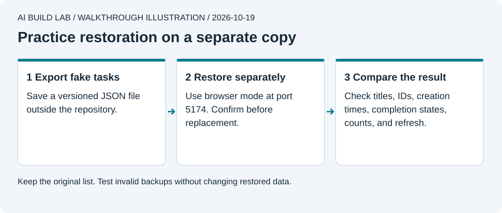

# 9. Keep it working

You will restore an exported task list, review service usage, and update one dependency on a branch.

Allow 45 to 60 minutes after lesson 8, or after lesson 7 if you stayed local. The restore exercise uses a disposable browser copy. It needs no paid backup product.



Authored walkthrough illustration. A backup is useful only after you demonstrate that you can restore it.

## Export and restore your tasks

```text
Read lesson 9. Help me add a versioned JSON export of the current user's
entire task list, including tasks hidden by filters. Use the reference format.
For restore practice, prepare a separate local browser-storage copy with no
cloud environment values, no credentials, and a different port.
Never replace my live list or restore into the hosted database.
```

1. Start from updated local `main` and create a `backup-restore` branch. Use fake tasks with distinct names. Complete one and leave another active. Add **Export tasks** and a browser-mode-only **Restore a backup** control using the reference's [backup functions](../reference/tiny-wins/src/tasks.ts) and [interface](../reference/tiny-wins/src/App.tsx). Validate the whole file and request confirmation before replacing a browser list. Keep cloud restore unavailable. Export every task available to the current user, not only the current view. Save the downloaded JSON outside the repository.
2. Open the export as text. It must contain a format version, each task's ID, title, completion state, and creation time. Exclude login tokens, passwords, and API credentials.
3. Ask the AI to create `work/restore-practice` from the updated app source, package manifest, and lockfile. Exclude `.git`, dependencies, build output, `.wrangler`, and **all actual environment files**. Both Supabase values must be empty in this copy, including inherited process settings. Have it run `npm ci` there, then `npm run dev -- --port 5174`. The reference's `dev` script already supplies `127.0.0.1` and `--strictPort`; retain those settings.
4. Open `http://127.0.0.1:5174` and confirm the app says it uses browser storage. Add a disposable task so you can see replacement happen. Export that list too before restoring.
5. Choose **Restore a backup** in the disposable copy and select the original export. Check the confirmation's task count before accepting replacement.
6. Compare every title, completion state, ID, creation time, and total count. Refresh and compare again. Try an invalid JSON file; it must show an error and leave the restored list unchanged. Stop the restore server when done. Run the main app's checks, review the feature branch, and [merge it back into local `main`](../docs/local-workflow.md#finish-a-feature-branch).

Do not delete the original list to prove a backup works. The reference limits restores to browser storage. Cloud import needs a separate design for ownership, ID conflicts, validation, and transactions.

| What this export covers | What it does not cover |
| --- | --- |
| The current user's exported task fields | Other users' data, Auth accounts, passwords, database schema, policies, uploads, or service configuration |

For a real service, plan database and file backups separately. Check [Supabase's backup guide](https://supabase.com/docs/guides/platform/backups) for your plan and prove a restore into a separate project before relying on it. A Git clone restores source history, not database contents.

## Review usage

If you deployed, open your Supabase and Cloudflare dashboards. Compare actual database size, requests, storage, and other usage with the current plan allowances. Check project pause notices and auth failures. Record the date and anything needing action. Free projects may pause; the app needs a useful connection error rather than a false success.

If you stayed local, record this review as not applicable. Check disk use and stop this lesson's local services when you are finished. An AI chat does not monitor these services between sessions unless you configure a real monitoring task.

## Update one dependency

1. Make a clean checkpoint and a branch named `maintenance-update`. Ask the AI to check the package owner's release notes, Node support, and migration guidance. Choose one supported patch update with a reason. If there is no suitable update, review the current release and record that no change is needed.
2. Ask it to show the exact package and version before installation. Pin the selected version, update the lockfile, and inspect the diff. Avoid a blanket upgrade or `npm audit fix --force`.
3. Use `npm ci` to verify that the committed manifest and lockfile install together. This replaces installed dependencies. Run `npm run check` and the browser checks. If auth or database code changed, rerun access checks too.
4. Review the pull request and merge only after checking the results. Publishing the update is a separate release decision. [npm ci](https://docs.npmjs.com/cli/v11/commands/npm-ci).

Finish by [updating local `main`](../docs/local-workflow.md#finish-a-feature-branch) from the merged result.

If the update fails, keep the failure evidence. Restore the previous manifest and lockfile on the branch, reinstall with `npm ci`, and recheck. Preserve unrelated work.

## If a secret leaks

Stop the action that is exposing it. Revoke the credential or rotate it, which replaces it and invalidates the old one, through the provider's official account controls. Update legitimate users of that credential privately and check the provider's activity records for unexpected use. A suspicious integration also needs its access revoked or disconnected.

Deleting a chat message, source line, or latest file does not invalidate a credential or remove every copy. For a GitHub leak, follow [GitHub's recovery guide](https://docs.github.com/en/authentication/keeping-your-account-and-data-secure/removing-sensitive-data-from-a-repository). Coordinate any history cleanup; avoid an automatic force-push or repository reset.

Practice without changing any account. Imagine that `DEMO-NOT-A-REAL-CREDENTIAL` appeared in a shared commit. Tell the tutor what you would stop, which provider control you would use, and why a new commit deleting it is insufficient. This is a discussion exercise. The marker has no access to revoke. Keep real credential values out of the recovery note.

## Try it yourself

Write a recovery note someone else could follow. Include the backup location, restore destination, checks, source commit, deployed version if any, and what the backup omits. Explain which event needs a source rollback, a data restore, or both. Keep credentials out of the note.

[Previous](08-put-it-online.md) · [Next: build your own feature](10-build-your-own-feature.md)
