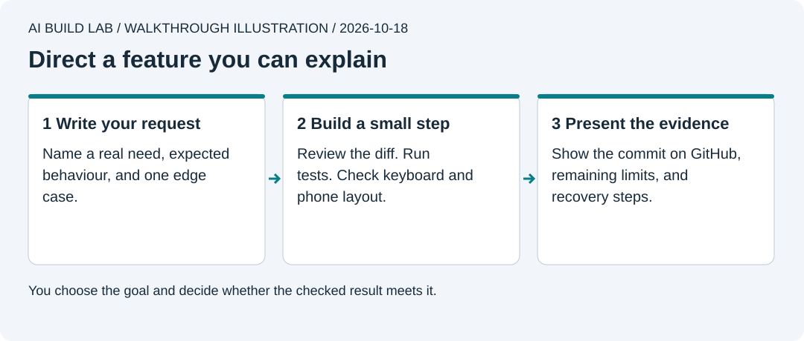

# 10. Build your own feature

You will direct a small feature from request to review without copying a prepared prompt.

Allow one or two sessions after lesson 9. Choose a change that fits the existing app and tools. New paid services, real personal data, and public releases need a separate decision.

Authored walkthrough illustration. You own the goal and the acceptance decision.

## Choose a small change

Pick something you would use, such as searching task titles or showing a completed-task count. A new payment system or social network is too large for this exercise.

1. Write who needs the change and what they cannot do today.
2. Write at least one ordinary case, one edge case, and what must keep working. Include keyboard use and a phone-sized screen.
3. Ask the AI to find the relevant official documentation and explain the part your change needs. Open the source yourself. If it needs a new dependency, require a reason the current tools cannot do the job.
4. Ask for a short plan, affected files, checks, and recovery steps. If the feature touches database structure or access, include migration compatibility and repeat the two-user access test.

Use [the feature brief template](../templates/feature-brief.md) if writing a blank request feels difficult. Fill it in yourself before asking the AI to improve it.

## Direct the work

Create a clean checkpoint and a feature branch in your own app repo. Ask for one small step, predict what will happen, and inspect the diff. Run the app and check the result yourself. Continue only when the current step behaves as expected.

Add a test that would fail if the feature broke. Run the full app checks. Review the changed lines, staged files, author, committer, branch, and GitHub destination before committing and pushing. Use a pull request to review the final result.

Do not accept "all done" as evidence. If you did not see a test run or check a behaviour, record it as unverified. If you stayed local in lesson 8, there is no deployment to claim.

## Present your result

Show someone else:

- Your original request and the acceptance checks.
- The relevant source and what you learned from it.
- The changed lines and why they solve the request.
- Actual test output and your browser, keyboard, and phone-size checks.
- The commit ID and the same commit on your GitHub repo.
- A recovery method and any remaining limits.

Have them ask for one small adjustment. Make it using the same process. If you cannot explain a changed line, ask the AI to explain it using the task in front of you, then explain it back in your own words.

For rollback practice, use a disposable branch or copy. Preserve your completed feature. Do not reset a shared branch or restore over real user data.

## Decide what comes next

You now have a repeatable way to request, review, test, save, and recover app changes. Choose your next project based on a real need. A responsive web app can work well on a phone. Native phone apps add platform components, permissions, signing, and release requirements; the optional native mobile track still needs its own lessons.

Use the [tool and cost review](../docs/tools-and-costs.md) before choosing another service. Add a tool when it solves a specific problem you can explain.

[Previous](09-keep-it-working.md) · [Return to the learning path](../docs/learning-path.md)
